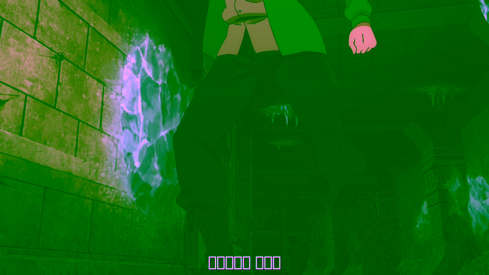

# Jellyfin Android 端转码画面发绿：原因和解决办法

> 环境：RK3399（rk3399-smart-am40）+ Armbian 6.12.111（rkmpp 补丁内核）+ Jellyfin（jellyfin-ffmpeg）
> 记录时间：2026-10-11，最终方案 = librga 两段式硬件混合

## 现象

测试片源是 `1.mkv`，1080p HEVC Main10，内挂 ASS 中文字幕。用浏览器打开 Jellyfin 网页端，转码播放一切正常；换 Android 客户端（试了两台设备都一样），画面整体发绿。

网页正常、Android 不正常，说明服务端转码本身没坏，问题出在两条客户端走的路径不一样的地方。

## 两条转码路径差在哪

Jellyfin 服务端是按客户端能力生成 ffmpeg 命令。抓了 `/var/log/jellyfin/FFmpeg.Transcode-*.log` 里的命令对比：

网页端不带字幕烧录，滤镜很简单，走 `vpp_rkrga` 做一次硬件缩放/格式转换就完事：

```
... -i 1.mkv -vf ...vpp_rkrga=format=nv12:afbc=1... -c:v h264_rkmpp ...
```

Android 客户端会要求把字幕烧进画面，命令就复杂了。字幕先用 libass 渲染成带透明的 BGRA 图层，再和视频帧合成：

```
-filter_complex "alphasrc=...,format=bgra,subtitles=2.ass:alpha=1,
    hwupload=derive_device=rkmpp[sub];
    [0:0]setparams=color_primaries=bt709:color_trc=bt709:colorspace=bt709[main];
    [main][sub]overlay_rkrga=eof_action=pass:repeatlast=0:format=nv12:afbc=1"
```

差别就在 `overlay_rkrga`：它把 BGRA 字幕层（已经 `hwupload` 成硬件缓冲）和主画面的 NV12 帧一起丢给 RGA2 这个 2D 引擎，在硬件里做 alpha 混合。网页路径从头到尾没碰过这个混合操作。

## 为什么会绿：RGA2 做不了这种单趟混合

亮度（Y）没受影响，所以画面轮廓清楚；色度全坏，整张图就绿了。起初以为是驱动 CSC 位没配对，在内核 `rga2_reg_info.c` 里强制改写目标色彩转换模式，寄存器确实写进去了，输出一个字节都没变——这才意识到不是配置问题。

于是写了个探针程序直接调 librga 的底层接口，把 RGA2 支持的组合逐个试了一遍，能力矩阵是这样：

| 主画面输入 | 图层 | 输出 | 结果 |
|---|---|---|---|
| YUV | — | YUV | 正常 |
| RGB | — | RGB | 正常 |
| RGB | — | YUV | 正常（目标 R2Y 生效） |
| YUV | — | RGB | 正常（源 Y2R 生效） |
| YUV | RGB | RGB | 正常 |
| RGB | RGB | YUV | 正常 |
| **YUV** | **RGB** | **YUV** | **坏的：输出是原始 RGB 混合结果** |

问题组合就是最后一种——主画面要先做 YUV→RGB（才能和 RGB 字幕混合），混合完还要做 RGB→YUV 写回 YUV 目标。RGA2 一趟流水线里这两步互相冲突，**后半程 RGB→YUV 被硬件静默旁路**，混合完的 RGB 数据原样灌进 YUV 平面。这正是 `overlay_rkrga` 每次都走的组合。



这是硬件行为，RK3399 上必现，驱动层修不了（寄存器位被无视）。

## 修复思路：librga 拆两趟，全程留在硬件

既然一趟做不了，那就拆成两趟，中间垫一个 RGB 暂存缓冲最适合放在 librga 里做，因为 Jellyfin 的 ffmpeg 动态链接 `librga.so.2`，换掉这个 .so 就生效，一个字节都不用重编。补丁改在 `RkRgaBlit` 入口，只拦"YUV 主画面 + RGB 图层 → YUV 输出且要求混合"这一种组合，其他组合原样放行：

```
第 1 趟：YUV 主画面 → RGB 暂存缓冲       （硬件 YUV→RGB，不混合）
第 2 趟：RGB 暂存 + RGB 字幕 → YUV 输出  （硬件混合 + RGB→YUV）
```

暂存缓冲按输出尺寸从 dma-heap 分配一次，之后按尺寸缓存复用。整个链路解码、混合、编码全在硬件，CPU 零开销。

**色彩矩阵有个坑值得记下来。** 两趟必须用"互逆"的一对矩阵，否则往返一次就引入系统性偏移。实测这批硬件上 BT.601 一对（Y2R=limit / R2Y=limit）往返 53.5 dB，基本无损；BT.709 一对只有 32 dB——它的双向矩阵在这批硅片上**不是严格互逆**，第一版补丁按片源标称的 709 走，结果整段画面亮度系统性偏移约 3.5，PSNR 卡在 32 dB。最终补丁固定用 601 对，709 片源的色度有 53.5 dB 量级的极小偏差，肉眼不可见。

装好补丁后，同样的字幕段 60 帧逐帧对比，做了两组基准：

- 修复前（原版 librga）：14–16 dB，0/60 帧合格（绿屏）
- 修复后 vs 纯软解真值：47.8–48.4 dB，60/60 帧全部 ≥40 dB
- 修复后 vs 同管线真值（rkmpp 硬解 + RGA 缩放，仅叠加步骤用软件）：**51.0–51.9 dB，60/60 全部合格**

51.9 已经贴近 601 矩阵往返 53.5 dB 的理论上限，剩下的差距是 RGA 10bit→8bit 转换的舍入噪声，肉眼不可见。（纯软解基准低 3–4 dB 是软缩放和硬缩放舍入不同造成的基准误差，不是修复的问题。）

同一帧修复前 / 修复后 / 真值对比（中心区域裁切）：


dmesg 里能看到补丁工作的痕迹：

```
rga split overlay: scratch fd=39 wstride=1920 size=6220800
```

## 实现方式：wrapper v2 + 补丁版 librga

服务端改不了滤镜图，所以在 ffmpeg 上动手：真二进制挪成 `ffmpeg.bin`，原路径放 wrapper 脚本。v2 的改动很轻：

1. 剥掉 `-afbc <val>` 全局参数（RGA2 消费不了 AFBC，不剥转码起不来，这是另一个独立问题）；
2. 把 `overlay_rkrga` 滤镜参数里的 `:afbc=N` 也剥掉（RGA2 吐不出 AFBC 输出）；
3. 滤镜图**原样透传**——字幕烧录完整留在 RGA 硬件上。

绿屏的修复本体在补丁版 `librga.so.2.1.0`（仓库里 `librga.so.2.1.0.rga-split`，源码改动见 `librga-rga-split-RockchipRga.cpp`）。**注意 wrapper v2 必须搭配补丁版 librga**，只装 wrapper 的话绿屏会回来。

仓库 `jellyfin-rkmpp-wrapper/` 里 `install.sh` 一键装齐四样：wrapper、补丁版 librga（原版自动备份为 `.orig`）、CJK 回退字体（不装的话烧录中文字幕是方块）、重启服务。

## 上一方案：CPU 软解方案（已淘汰）

最早的修复是把字幕合成挪到 CPU：`scale_rkrga` 桥接出可下载帧 → `hwdownload` → 软件 `overlay` → `hwupload` 回硬件编码。这个方案画质没问题，但 1080p 转码速度从 3.6 倍实时掉到 0.86 倍实时——每帧 6MB 的两次内存搬运加一次 CPU 合成，1080p 24fps 勉强能跟，4K 直接歇菜。现在硬件混合修好了，这套链路只在 librga 补丁缺失时才有存在价值，wrapper v2 已经不再做这个改写。

## 性能

1080p HEVC Main10 → H264：字幕烧录走 RGA 两趟混合后，转码速度和不烧字幕基本持平（约 3.6 倍实时）。软解真值链路（CPU 解码+CPU 合成）只有约 7 fps，两相对照也能看出硬件混合几乎不花时间。
