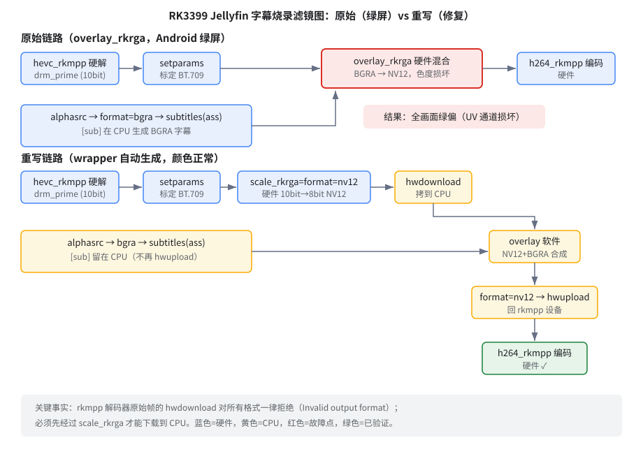

# Jellyfin Android 端转码画面发绿：原因和解决办法

> 环境：RK3399（rk3399-smart-am40）+ Armbian 6.12.111（rkmpp 补丁内核）+ Jellyfin（jellyfin-ffmpeg）
> 记录时间：2026-10-11

## 现象

测试片源是 `1.mkv`，1080p HEVC Main10，内挂 ASS 中文字幕。用浏览器打开 Jellyfin 网页端，转码播放一切正常；换 Android 客户端（试了两台设备都一样），画面整体发绿。

网页正常、Android 不正常，说明服务端转码本身没坏，问题出在两条客户端走的路径不一样的地方。

## 两条转码路径差在哪

Jellyfin 服务端是按客户端能力生成 ffmpeg 命令。抓了 `/var/log/jellyfin/FFmpeg.Transcode-*.log` 里的命令对比：

网页端不带字幕烧录，滤镜很简单，走 `vpp_rkrga` 做一次硬件缩放/格式转换就完事：

```
... -i 1.mkv -vf ...vpp_rkrga=format=nv12:afbc=1... -c:v h264_rkmpp ...
```

Android 客户端会要求把字幕烧进画面，命令就复杂了。字幕先用 libass 渲染成带透明的 BGRA 图层，再和视频帧合成：

```
-filter_complex "alphasrc=...,format=bgra,subtitles=2.ass:alpha=1,
    hwupload=derive_device=rkmpp[sub];
    [0:0]setparams=color_primaries=bt709:color_trc=bt709:colorspace=bt709[main];
    [main][sub]overlay_rkrga=eof_action=pass:repeatlast=0:format=nv12:afbc=1"
```

差别就在 `overlay_rkrga`：它把 BGRA 字幕层（已经 `hwupload` 成硬件缓冲）和主画面的 NV12 帧一起丢给 RGA2 这个 2D 引擎，在硬件里做 alpha 混合。网页路径从头到尾没碰过这个混合操作。

## 为什么会绿

RGA2 做 BGRA→NV12 的硬件混合时写出来的 UV 分量是错的。亮度（Y）没受影响，所以画面轮廓清楚；色度全坏，整张图就绿了。这是硬件混合通路上的驱动/硬件层面问题，在 RK3399 上必现，跟播放器版本、片源都没关系。

先在板上把两条命令各跑一遍、抽帧对比，确认了这个判断：


量了一下上面这帧的 RGB 均值：G 通道 105 左右，R 只有 23——正常画面这两个数应该差不多。网页路径抽出来的帧（见文末 fA.png）三通道是均衡的。问题就锁定在 `overlay_rkrga` 这一个滤镜上。

## 怎么修：把合成那一步挪到 CPU

思路很简单：解码、编码继续用硬件（rkvdec / h264_rkmpp），只有"字幕和画面合成"这一步改在 CPU 上用软件 `overlay` 做。改完的滤镜图长这样：



想法直接，做起来踩了几个坑，值得记下来。

**坑一：解码器吐出来的帧没法下载到 CPU。** 最先试的链路是 `hwdownload` 之后接软件 overlay，结果不管 `hwdownload` 后面写 `nv12`、`p010le`、`yuv420p10le` 还是 `yuv420p`，甚至什么都不写，全部报同一个错：

```
[hwdownload] Invalid output format nv12 for hwframe download.
```

也就是说 rkmpp 的 hwcontext 压根不支持从解码输出帧直接往 CPU 搬数据。

**坑二：过一道 `scale_rkrga` 就能下载了。** 在解码器后面加一级 `scale_rkrga=format=nv12:afbc=0`（纯硬件，顺手把 10bit 转成 8bit NV12），它输出的帧上下文是支持 `hwdownload` 的。这一级滤镜其实干了两件事：硬件格式转换 + 把帧变成"可下载"的。这也是为什么最终链路里它不能省。

**坑三：字幕图层不再上硬件。** 原命令把 BGRA 字幕 `hwupload` 进硬件再混合；改写时把这个 `hwupload` 删掉，让字幕留在 CPU 域，跟下载下来的主画面直接在软件里合成，合成完 `format=nv12` 再 `hwupload=derive_device=rkmpp` 送回硬件编码。

最终链路：

```
scale_rkrga=format=nv12:afbc=0  （硬件：10bit→8bit NV12，同时变成可下载帧）
→ hwdownload,format=nv12        （搬到 CPU）
→ overlay                       （软件合成 BGRA 字幕）
→ format=nv12 → hwupload=derive_device=rkmpp  （搬回硬件）
→ h264_rkmpp                    （硬件编码）
```

用和 Jellyfin 一模一样的命令在板上跑通 240 帧，抽帧量 RGB：R/G ≈ 1.0，颜色正常。中间还顺手发现另一个问题——字幕烧出来了但中文全是方块，日志里有 `fontselect: failed to find any fallback with glyph`。原因很朴素：系统里一个中文字体都没有，libass 找不到字形可用。从宿主机拷了个 `DroidSansFallbackFull.ttf` 到 `/usr/share/fonts/truetype/droid/` 再 `fc-cache -f` 就好了。这跟绿屏无关，但不修的话所有走字幕烧录的客户端中文都是方块，所以一起算进修复里。

最后用 Jellyfin 日志里 Android 客户端触发的原始命令（只改了输出路径）完整验证：


## 落地方式：ffmpeg wrapper

Jellyfin 每次转码在服务端配置改不了滤镜图，所以选择在 ffmpeg 上做文章：把真二进制挪成 `ffmpeg.bin`，原来的 `ffmpeg` 路径放一个 bash 脚本，在参数层面动两处手脚：

1. 剥掉 `-afbc <val>`。这是另一个独立问题——Jellyfin 给 rkmpp 硬解硬编码了这个参数，但 RK3399 的 RGA 根本消费不了 AFBC 帧，不剥掉转码直接起不来（详细说明见仓库 README）。
2. 参数里出现 `overlay_rkrga` 时，用 sed 把整张 `-filter_complex` 改写成上面的软件合成链路。其他命令原样透传，网页路径完全不受影响。

## 手动部署（已经刷好机的板子）

如下：

```bash
cd /usr/lib/jellyfin-ffmpeg

# 1. 真二进制改名保留（只做一次，重装 jellyfin-ffmpeg 后要重做）
cp -a ffmpeg ffmpeg.bin

# 2. 把 wrapper 脚本写到这里并加执行权限
#    脚本内容见仓库 jellyfin-rkmpp-wrapper/jellyfin-rkmpp-wrapper.sh
chmod 755 /usr/lib/jellyfin-ffmpeg/ffmpeg

# 3. 中文字体（不装的话烧录字幕的中文是方块）
mkdir -p /usr/share/fonts/truetype/droid
cp DroidSansFallbackFull.ttf /usr/share/fonts/truetype/droid/
fc-cache -f

# 4. 重启服务
systemctl restart jellyfin
```

验证：用 Android 客户端放一次带字幕的片，然后看日志里最新一条转码命令——开头应该是 wrapper，`-afbc` 没了，原来 `overlay_rkrga` 的位置变成 `scale_rkrga=...hwdownload...overlay...hwupload`。回滚就是把 `ffmpeg.bin` 改回 `ffmpeg`。

## 性能

1080p HEVC Main10 → H264，实测：不带字幕烧录（网页直转）大约 3.6 倍实时；带字幕烧录掉到 0.86 倍实时。掉的这部分就是每帧两次内存搬运（hwdownload/hwupload 各 3MB 左右）加一次 CPU 合成的开销。1080p 24fps 还能勉强实时；4K 或者高帧率的片源建议关掉字幕烧录，或者降分辨率转。
